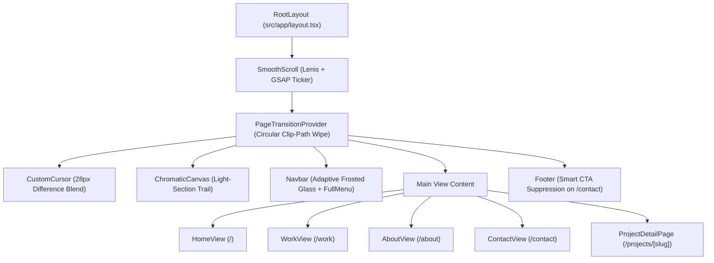

# Design System & Aesthetic Analysis — Rubbas Yar Khan Portfolio (`RUBBAS .YK`)

## 1. Aesthetic Direction & Design Philosophy

The **Rubbas Yar Khan (`RUBBAS .YK`)** portfolio embodies an **Editorial Neo-Brutalist & Kinetic Luxury** aesthetic—inspired by Awwwards-winning creative developer showcases and contemporary digital design studios.

### Core Aesthetic Pillars
1. **High-Contrast Dual-Theme Polarity**:
   - Rather than a static dark or light toggle, the website choreographs **scroll-driven atmospheric shifts** between **Obsidian Dark (`#0B0D10`)** and **Warm Editorial Linen (`#F1EFEB`)** via GSAP `ScrollTrigger` (`section[data-color="black" | "white"]`).
   - Dark sections project cinematic depth, technical precision, and drama (Hero, Disciplines/Skills, Contact, Footer).
   - Light sections evoke tactile print editorials, gallery curation, and human warmth (Selected Work, Client Trust/Testimonials, About Me, Case Studies).

2. **Monumental Editorial Typography**:
   - Oversized, tightly-tracked uppercase display headlines (`leading-[0.85]` to `leading-[0.9]`, `tracking-tighter`, fluid `clamp()` sizing) paired with technical monospace metadata tags in square brackets (e.g., `[ 03 // DISCIPLINE & SERVICES ]`, `[ UP NEXT ]`, `// PRODUCTION LAUNCH • SOCIAL PROOF`).
   - Expressive typographic juxtaposition inside the hero marquee: mixing geometric sans-serif (**Space Grotesk**), classic high-contrast serif (**Playfair Display**), and fluid script (**Allura**) separated by geometric clip-path primitives (diamonds, triangles, stars, octagons).

3. **Physics-Based & Choreographed Motion (60fps)**:
   - **Lenis Smooth Scrolling** coupled directly to the **GSAP Ticker** (`lagSmoothing(0)`) ensures weightless, inertia-driven scroll physics.
   - **Circular Clip-Path Architecture**: Used consistently as a signature visual motif across three layers:
     1. The Hero section's scroll-scrubbed expanding/contracting circular viewport mask (`.vdiv` using `clip-path: circle(var(--clip) at 50% 50%)`).
     2. The Fullscreen Navigation Menu curtain reveal (`clip-path: circle(150% at 100% 0%)`).
     3. The `<TransitionLink>` route transition overlay that wipes from top-right (`100% 0%`) to bottom-left (`0% 100%`).

4. **Tactile Micro-Interactions & Surface Grain**:
   - **Animated SVG Fractal Noise Overlay** (`.noise-overlay` at `0.08` opacity, stepping every `0.35s`) adds analog film texture across desktop viewports.
   - **Inverting Custom Cursor**: A `28px` white circular cursor (`mix-blend-mode: difference`) driven by a `0.25` lerp physics loop that scales `2.5x` over interactive targets (`a`, `button`, `.card`, `.project-card`, `.discipline-card`).
   - **Interactive Chromatic Canvas**: On light-theme background space, cursor movement paints velocity-sensitive quadratic Bézier strokes that shift hue and dissolve organically (`mix-blend-multiply`).
   - **Rolling Text Mask Buttons (`.masker`)**: Navigation links and CTAs use dual-layer vertical text translation (`-translate-y-full` / `translate-y-0`) revealing gold (`#F5B942`) or inverted text on hover.

---

## 2. Color System & Tokens

Defined in [`src/app/globals.css`](file:///c:/Users/DELL/Documents/Projects/portfolio/src/app/globals.css) and [`tailwind.config.ts`](file:///c:/Users/DELL/Documents/Projects/portfolio/tailwind.config.ts):

### Dark Theme (`body[theme="black"]` / `data-color="black"`)
| Token / Role | Hex / Value | Usage |
| :--- | :--- | :--- |
| **Background Primary** (`--bg-dark`) | `#0B0D10` | Main dark canvas (Hero, Skills, Contact, Project Up-Next) |
| **Footer Canvas** | `#000000` | Deep pure black footer background |
| **Surface / Card** (`--surface-dark`) | `#13161B` / `#1A1A1A` | Elevated dark cards, interactive channel blocks, containers |
| **Border Subtle** (`--border-dark`) | `#1F232B` / `rgba(255,255,255,0.10)` | Hairline structural dividers, card borders, grid lines |
| **Text Primary** (`--text-primary-dark`) | `#E6E6E6` / `#FFFFFF` | Display headings, primary body copy, active links |
| **Text Secondary** (`--text-secondary-dark`) | `#9CA3AF` (`text-zinc-400`) | Supporting descriptions, subtitles |
| **Text Muted / Technical** (`--text-disabled-dark`) | `#6B7280` (`text-zinc-500`) | Monospace index numbers (`/ 01`), metadata labels |

### Light Theme (`body[theme="white"]` / `data-color="white"`)
| Token / Role | Hex / Value | Usage |
| :--- | :--- | :--- |
| **Background Primary** (`--bg-light`) | `#F1EFEB` | Warm alabaster/linen editorial background (Work, About, Testimonials) |
| **Surface / Card** (`--surface-light`) | `#FFFFFF` | Testimonial showcase cards, tech badges, elevated containers |
| **Border Subtle** (`--border-light`) | `#E5E2DC` / `rgba(0,0,0,0.15)` | Card borders, section hairlines |
| **Text Primary** (`--text-primary-light`) | `#0B0D10` | High-contrast ink black headlines and primary copy |
| **Text Secondary** (`--text-secondary-light`) | `#5E636E` (`text-zinc-600`) | Editorial paragraphs, project category tags |
| **Text Muted** (`--text-disabled-light`) | `#8A8F99` (`text-zinc-500`) | Metadata captions, secondary labels |

### Brand & Accent Palette
| Token / Role | Hex / Value | Usage |
| :--- | :--- | :--- |
| **Gold Primary** (`--accent-primary`) | `#F5B942` | Signature brand accent, text selection, hover states, status indicators, script highlights |
| **Gold Muted** (`--accent-muted`) | `#D9A737` / `#B8810E` | Darker gold for light-background legibility (links, quotes) |
| **Gold Soft** (`--accent-soft`) | `#FFF3D6` | Subtle tint highlights |
| **Warm Terracotta** | `#ef9d71` | Secondary warm accent used on the Contact view for indicator dots, icon badges, and interactive hover highlights |

---

## 3. Typography System

Configured via `next/font/google` in [`src/app/layout.tsx`](file:///c:/Users/DELL/Documents/Projects/portfolio/src/app/layout.tsx) and local `@font-face` declarations in [`src/app/globals.css`](file:///c:/Users/DELL/Documents/Projects/portfolio/src/app/globals.css):

| Font Family | CSS Variable / Tailwind Class | Role & Aesthetic Character |
| :--- | :--- | :--- |
| **Space Grotesk** | `var(--font-space-grotesk)` / `font-sans` | Primary UI & display typeface. Used in `font-bold`, `font-extrabold`, and `font-black` with uppercase tracking (`tracking-tighter`) for monumental section headers. |
| **Neue Machina** | `font-machina` (`Neue-Machina.ttf`) | Technical, wide-stance display grotesque with deep ink-traps. Used in the fullscreen navigation menu links and footer `LET'S BUILD SOMETHING` display stack. |
| **Satoshi Variable** | `font-satoshi` (`Satoshi-Variable.ttf`) | Clean modern grotesque used in the footer grid, menu inquiry details, and structured UI blocks. |
| **Playfair Display** | `var(--font-playfair)` / `font-serif` | High-contrast editorial serif used in hero marquee keywords (`pixel-perfect`, `modern`, `scalable`) and oversized testimonial quotation marks. |
| **Allura** | `var(--font-allura)` / `font-script` | Calligraphic script used for expressive focal words (`behave`, `innovative`, `creative`, `interactive`). |
| **System Monospace** | `font-mono` | Technical metadata, bracketed section tags (`[ 03 // DISCIPLINE & SERVICES ]`), index counters (`01`–`07`), and contact labels. |

### Fluid Typographic Scale
- **Hero / Page Display (`h1`)**: `text-[clamp(3.2rem,9.5vw,8.5rem)]` or `text-[clamp(3.5rem,8.5vw,7rem)]`, `leading-[0.85]`–`leading-[0.88]`, `tracking-tighter`, `uppercase`, `font-extrabold` / `font-black`.
- **Section Display (`h2`)**: `text-[clamp(3rem,8vw,6.5rem)]`, `leading-[0.85]`–`leading-[0.88]`, `tracking-tighter`, `uppercase`, `font-black`.
- **Bracketed Metadata Label**: `text-xs font-mono uppercase tracking-[0.25em]` or `tracking-[0.3em]`.

---

## 4. Layout, Grid & Component Architecture

### Signature Component Patterns
1. **Frosted Glass Adaptive Navbar ([`Navbar.tsx`](file:///c:/Users/DELL/Documents/Projects/portfolio/src/components/layout/Navbar.tsx))**:
   - Uses hardware-accelerated `backdrop-filter: blur(12px) saturate(180%)` without `mix-blend-difference` (avoiding Chromium compositing conflicts).
   - Dynamically samples `section[data-color]` at `Y = 45px` to switch background tint (`rgba(241, 239, 235, 0.58)` in light mode vs. `rgba(11, 13, 16, 0.58)` in dark mode) and text contrast (`#0B0D10` vs. `#FFFFFF`).
2. **Project Showcase Cards ([`ProjectCard.tsx`](file:///c:/Users/DELL/Documents/Projects/portfolio/src/components/ui/ProjectCard.tsx))**:
   - `aspect-[16/10]` media container in `bg-zinc-900 rounded-sm`.
   - Images rest in `grayscale` and transition on hover (`duration-500 group-hover:grayscale-0 group-hover:scale-105`).
   - Top border hairline (`border-t border-black/15 pt-4`) with uppercase title on the left, monospace index (`01`) on the right, and bullet-separated category labels underneath.
3. **Interactive List & Channel Cards ([`DisciplineCard.tsx`](file:///c:/Users/DELL/Documents/Projects/portfolio/src/components/ui/DisciplineCard.tsx))**:
   - Hairline borders (`border-white/10`) with an animated bottom accent bar (`group-hover:bg-[#F5B942]`).
   - Monospace index prefix (`/ 01`), uppercase Space Grotesk title shifting to accent color on hover, and concise supporting copy.
4. **Smart Footer ([`Footer.tsx`](file:///c:/Users/DELL/Documents/Projects/portfolio/src/components/layout/Footer.tsx))**:
   - Features a right-aligned stacked `LET'S BUILD SOMETHING` headline with a magnetic pill button (`START NOW`).
   - Automatically detects `pathname === '/contact'` and suppresses the duplicate top CTA block so the Contact page flows directly into the 4-column info grid.
